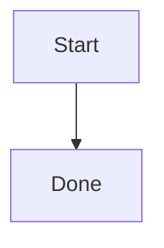

# 操作说明（保留原 README 工作流）

> 迁入日期：2026-09-07，来源 `545f592200cd7cf0583fb7ad3874abf8e17d0000` 的 README。
> 本文件保留原始命令与示例，便于已有用户沿用原工作流；项目边界、优先级、当前计划以 [PROJECT](../PROJECT.md) 与 [ARCHITECTURE](ARCHITECTURE.md) 为准。
> 本节未覆盖的 SpecMesh 文档：见 [PROJECT](../PROJECT.md) / [AGENTS](../AGENTS.md) / [DECISIONS](DECISIONS.md) / [当前计划](../plans/2026-09-draft-workflow-reliability/task_plan.md)。

---

# qiao wechat

`qiao wechat` 是这套公众号内容链路的公开版名称。

Python-only 架构源码：把 wxAiPost 适合借鉴的「后台/发布链路」拆出来，再补一个 WeMD-like 的微信排版层。

运维约束和账号能力边界见 [OPS.md](../OPS.md)。

## 定位

- 不照搬 wxAiPost 的 Go + Vue + MySQL。
- 保留它值得借鉴的部分：账号表、token 缓存、封面素材上传、草稿创建、发布提交、发布记录、后台 API 雏形。
- 排版层单独实现：Markdown → 微信兼容 inline HTML → 本地手机宽度预览 → 草稿。
- 小红书采用安全导出包，不做绕过登录/风控的自动化。

## 项目边界

本仓（公开名 `qiao-wechat`，包名 `qiao_wechat`；曾用旧名 `wx-content-mesh-python`）是发布与排版工具，不是这套公众号个人 IP 加工流程的总路由器。

如果你处理的是 `/srv/self-media-exchange/inbox/xueyu-gongzhonghao-receive` 这个同步公众号仓库里的文章，默认流程应当是：

1. 先走 repo-local `skills/wechat-project-workflow/SKILL.md`
2. 再显式经过 `super-writing`
3. 再由 `super-writing` 判断这次需要完整 `wechat-writer → wechat-anti-slop → wechat-format`，还是只落到最终包装阶段
4. 最后才进入本项目执行渲染、图片处理、草稿箱投递

特别注意：

- 对「代表账号风格发出去」的个人 IP 文章，`super-writing` 是必要路由。
- 不要把本项目当成跳过个人 IP 加工流程的捷径。
- 即使最终只是修微信兼容、做格式清理、或进草稿箱，这个结论也应该先经过上游内容 workflow 判断。

> 历史 README 把同步目录写为 `/srv/self-media-exchange/inbox/xueyu-gongzhonghao-receive`；该路径来自 `Settings.source_repo_dir` 的默认值（见 [config.example.env](../config.example.env)），是示例配置而非仓库约定，请按实际 `WCM_SOURCE_REPO_DIR` 调整。

## 排版引擎

当前 renderer 已经从「标签级 style dict」切到「主题 CSS 编译成 inline HTML」。

实际链路：

```text
theme stylesheet
  → selector 匹配
  → specificity / cascade
  → CSS 变量解析
  → inline style 输出
  → 微信公众号 HTML
```

当前已经覆盖：

- `.class` / `#id` / 相邻兄弟 / 后代选择器
- `--color-primary` 这类 CSS 变量
- 整份主题 CSS 编译后再 inline
- `plantuml` 代码块服务端转 SVG
- `mermaid` 代码块服务端转 SVG
- 行内/块级公式服务端转 SVG

主题文件位于 [`qiao_wechat/themes/`](../qiao_wechat/themes/)，元数据集中在 [`qiao_wechat/themes/metadata.json`](../qiao_wechat/themes/metadata.json)。当前内置主题：

- `wechat_baseline`（默认发布主题，负责稳定的公众号正文基线节奏，不承担预览卡片外壳）
- `wemd_clean` / `wemd_card`（偏 WeMD 取向的公众号正文主题）
- `default` / `grace` / `simple` / `modern`（复用了本地 `wechat-format` 内置模板结构，再改成 Python 侧可直接编译的主题 CSS）
- `academic_paper` / `bauhaus` / `knowledge_base` / `morandi_forest` / `receipt`（迁自 WeMD 官方模板目录，并适配到当前 `#wemd` + inline 编译链路）
- `wechat_standard_v2`（额外内置变体）

`wechat_baseline / wemd_clean / wemd_card / wechat_standard_v2` 在 `metadata.json` 中 source 标记为 `qiao-wechat`；其余主题分别标记为 `local wechat-format template` 或 `WeMD official templates`。

## 目录

```text
qiao_wechat/
├── app.py                         # FastAPI 后台雏形，自带 Swagger UI
├── cli.py                         # 命令行入口
├── config.py                      # 环境配置
├── db.py                          # SQLAlchemy DB 初始化
├── models.py                      # 账号/token/素材/文章/发布任务表
├── schemas.py                     # API schema
├── scheduler.py                   # 定时提交/轮询雏形
└── services/
    ├── renderer.py                # WeMD-like Markdown → inline HTML
    ├── wechat_client.py           # 微信 token/素材/草稿/预览/发布 API
    ├── image_service.py           # 图片下载、去重、hash、素材记录
    ├── publisher.py               # 渲染 → 上传图片 → 草稿 → 预览 → 发布
    ├── xhs_exporter.py            # 小红书笔记导出
    ├── creative_pipeline.py       # 研究员 → 作家 → 审核员 → 设计师
    ├── quality_gate.py            # 发布前质量/风险检查
    ├── html_normalizer.py         # HTML 入口兼容整理
    ├── obsidian_assets.py         # Obsidian 导出资产解析
    ├── visual_renderer.py         # 图形 URL 渲染
    ├── theme_manager.py           # 主题 CSS 与 metadata 管理
    ├── theme_gallery.py           # 主题画廊 HTML
    └── llm.py                     # OpenAI-compatible LLM 客户端
```

## Repo-local skills

项目内专属技能现在放在 [`skills/`](../skills/README.md)。

当前已内置一组偏科研写作/学术内容加工的 repo-local skills，作为公众号生成工作流的附带能力，而不是继续依赖外部同步 skill 目录：

- `nature-citation`
- `nature-data`
- `nature-figure`
- `nature-paper2ppt`
- `nature-polishing`
- `nature-response`

这些 skill 以完整目录形式随仓库管理，保留各自的 `references/`、脚本和示例文件，后续应优先在本仓内维护。

## 发布链路

```text
Article Markdown
  → render_article()
      Markdown → inline HTML
      local preview HTML
  → create_wechat_draft()
      upload inline images with media/uploadimg
      upload cover with material/add_material
      draft/add returns media_id
  → send_preview()
      message/mass/preview sends to openid/wxname
  → submit_freepublish()
      freepublish/submit returns publish_id
  → poll_publish_status()
      freepublish/get returns status/article_id
      freepublish/getarticle tries to hydrate article URL
```

图形/公式链路：

```text
Markdown
  → PlantUML/Mermaid/LaTeX 服务端转 SVG URL
  → inline HTML
  → create_wechat_draft()
      继续按普通正文图片上传到微信
  → 草稿箱里拿到最终效果
```

注意：「预览链接」在这里拆成两类：

1. `local_preview_url`：本机 FastAPI 上的 HTML 预览链接，适合排版审稿（与 `/preview/themes` 同进程）。
2. 微信手机预览：调用 `message/mass/preview` 发送到指定用户。微信接口不会为草稿直接返回公开预览 URL。

## 个人号边界

当前仓库已经验证过一个典型个人主体公众号的能力边界（[OPS.md](../OPS.md) 2026-04-28 实测）：

- 个人主体账号不等于可开通完整「微信认证」。
- 个人号可以启用 `AppSecret`、配置 IP 白名单、获取 `access_token`。
- 个人号可以创建草稿 `draft/add`。
- 个人号当前没有 `message/mass/preview` 权限，实测返回 `48001 api unauthorized`。
- 对 `freepublish/submit` 这类自动发布能力，不应默认认为个人未认证账号可用。

因此，当前项目默认按「草稿箱模式」运行：

- 开 `local preview`
- 开 `draft/add`
- 关 `preview`（`message/mass/preview`）
- 关 `freepublish/submit`

只有在确认账号能力足够后，才手动打开运行开关：

```bash
WCM_ALLOW_WECHAT_PREVIEW=true
WCM_ALLOW_WECHAT_PUBLISH=true
```

## 快速开始

```bash
uv sync --extra dev
cp config.example.env .env
uv run qiao-wechat init
```

启动后台（默认端口 8000；主题画廊同进程）：

```bash
uv run uvicorn qiao_wechat.app:app --reload
```

打开：

```text
http://127.0.0.1:8000/docs
http://127.0.0.1:8000/tools/html-draft
http://127.0.0.1:8000/preview/themes
```

> 历史 README 把 `preview/themes` 与 `themes/*` 写在 `:8001` 上，那是早期主题服务独立进程的写法；当前 `app.py` 已把主题画廊与管理 API 合并到主进程，请以实际启动命令端口为准。

本地渲染演示：

```bash
uv run python examples/demo_local.py
```

切主题重渲染：

```bash
uv run qiao-wechat render 1 --theme default
uv run qiao-wechat render 1 --theme grace
uv run qiao-wechat render 1 --theme wemd_card
```

主题管理接口（与 `/preview/themes` 同进程）：

```text
GET  /themes
GET  /themes/{theme_name}/css
POST /themes/import
POST /themes/import-file
PUT  /themes/{theme_name}/metadata
```

JSON 导入 CSS 模板：

```bash
curl -X POST http://127.0.0.1:8000/themes/import \
  -H "Content-Type: application/json" \
  -d '{
    "name": "my_theme",
    "display_name": "My Theme",
    "description": "自定义公众号 CSS 模板",
    "source": "user",
    "tags": ["custom", "wechat"],
    "overwrite": false,
    "css": "#wemd { color: #222; } #wemd h2 + p { margin-top: 4px; }"
  }'
```

文件上传导入：

```bash
curl -X POST http://127.0.0.1:8000/themes/import-file \
  -F "file=@./my_theme.css" \
  -F "name=my_theme" \
  -F "display_name=My Theme" \
  -F "source=user" \
  -F "tags=custom,wechat"
```

主题元数据集中保存在 [`qiao_wechat/themes/metadata.json`](../qiao_wechat/themes/metadata.json)。新导入的主题会自动写入这份文件；已有主题可通过 `PUT /themes/{theme_name}/metadata` 修改名称、说明、来源、预览封面和标签。

## 配置公众号账号

推荐把 secret 放到环境变量，再让账号表引用变量名：

```bash
export WX_ACCOUNT_MAIN_SECRET="你的 AppSecret"
uv run qiao-wechat add-account \
  --name main \
  --appid wx_xxx \
  --secret-env-name WX_ACCOUNT_MAIN_SECRET \
  --account-type service \
  --certified \
  --author "你的作者名" \
  --default-cover-media-id "已上传封面media_id"
```

也可以本地测试时直接传 `--secret`，但生产不建议。

默认安全开关（与 OPS.md 对齐）：

```bash
WCM_ALLOW_WECHAT_PREVIEW=false
WCM_ALLOW_WECHAT_PUBLISH=false
```

## 创建文章并预览

```bash
uv run qiao-wechat create-article \
  --account-id 1 \
  --title "wxAiPost 应该怎么借鉴，而不是照搬" \
  --markdown examples/sample_article.md \
  --cover ./cover.jpg \
  --theme wemd_card

uv run qiao-wechat render 1
```

图形/公式示例：

````markdown
```plantuml
Alice -> Bob: Hello
```



$$
E = mc^2
$$

行内公式：\(\alpha + \beta\) 或 $x^2 + y^2$
````

查看文章、质量检查和发布任务：

```bash
uv run qiao-wechat list-articles
uv run qiao-wechat inspect 1
uv run qiao-wechat jobs --article-id 1
```

## 创建微信草稿

```bash
uv run qiao-wechat draft 1
```

同一账号、同一内容修订的重复调用会复用已录得的草稿结果，不会重复创建远端草稿。若上一次尝试的结果未知（如远端超时），再次提交会被拦截；先到公众号后台草稿箱人工核对，确认未创建后再显式放行：

```bash
uv run qiao-wechat draft 1 --force-new
```

对应 API 字段为 `POST /articles/{id}/wechat/draft` 请求体中的 `"force_new": true`。任务历史可用 `GET /articles/{id}/jobs` 查询；失败任务的 `error_category` 区分 `remote_rejected`（远端明确拒绝）、`remote_result_unknown`（结果未知，先核对草稿箱）、`remote_unconfirmed`（素材上传结果未确认，可安全重试）、`validation_failed` 与 `local_error`。

批量创建草稿（draft-only；单篇失败不中断，逐篇反馈新建/复用/失败）：

```bash
uv run qiao-wechat draft-batch --article-id 1,2,3
uv run qiao-wechat draft-batch --article-id 1 --article-id 4
```

对应 API：`POST /wechat/drafts/batch`，请求体 `{"article_ids": [1,2,3], "upload_inline_images": true, "force_new": false}`，响应含逐篇结果与 created/reused/failed 汇总。

## 已渲染 HTML 直入草稿

这是给外部视觉/排版系统接入用的主入口。你的其它项目只需要产出最终微信公众号 HTML，本项目负责：

- 正文图片上传与 URL 替换
- 封面上传
- 本地预览文件生成
- `draft/add` 入草稿箱

CLI 入口：

```bash
uv run qiao-wechat html-draft \
  --account-id 1 \
  --html /srv/self-media-exchange/inbox/xueyu-gongzhonghao-receive/posts/runtime-governance/final.html \
  --title "多 Agent 运行时治理" \
  --cover /srv/self-media-exchange/inbox/xueyu-gongzhonghao-receive/posts/runtime-governance/assets/cover.png
```

HTTP JSON 入口（文件）：

```bash
curl -X POST http://127.0.0.1:8000/wechat/drafts/from-html-file \
  -H "Content-Type: application/json" \
  -d '{
    "account_id": 1,
    "html_path": "/srv/self-media-exchange/inbox/xueyu-gongzhonghao-receive/posts/runtime-governance/final.html",
    "title": "多 Agent 运行时治理",
    "cover_source": "./assets/cover.png",
    "options": {
      "upload_inline_images": true,
      "create_local_preview": true,
      "force_reupload_cover": false
    }
  }'
```

如果外部系统已经把 HTML 读进内存，不想再落地文件：

```text
POST /wechat/drafts/from-html
```

如果外部系统只产出最终文件：

```text
POST /wechat/drafts/from-html-file
uv run qiao-wechat html-draft ...
```

> 这三条入口都归到同一条后端发布链路（`prepare_html_article` → `create_wechat_draft`），没有分叉实现。

## 发送手机预览

```bash
uv run qiao-wechat preview 1 --openid USER_OPENID
# 或者，在账号允许的情况下：
uv run qiao-wechat preview 1 --wxname SOME_WECHAT_ID
```

注意：不是所有公众号账号都具备 `message/mass/preview` 权限。当前测试用个人主体账号已验证：

- `draft/add` 可用
- `message/mass/preview` 返回 `48001 api unauthorized`
- `freepublish/submit` 默认关闭，不对个人未认证号做自动发布假设

所以当前默认工作流应当是：

- 本地预览
- 推送草稿箱
- 在公众号后台人工检查并手动发布

## 提交发布并轮询

```bash
uv run qiao-wechat publish 1
uv run qiao-wechat poll 1
```

## 小红书导出

```bash
uv run qiao-wechat xhs-export 1 --tags 公众号排版 内容自动化 Python
```

## 最优解建议

- wxAiPost：借后台表结构和发布链路，不借排版。
- WeMD：借排版理念、本地优先、主题、深色模式预览理念；Python 侧用 inline renderer 复刻关键能力。
- wechat-publisher / wechat-official-publisher：借 token、多账号、图片上传、草稿创建、错误处理。
- xiaohu-wechat-format：借 Python 主题库、inline style、图片上传到草稿箱这条线。
- 最终系统：Python FastAPI + SQLAlchemy + renderer + publisher + scheduler。

## 生产化待补

1. `raw_secret` 加密，例如 KMS/Fernet/Vault。
2. 图片格式压缩与微信尺寸限制自动修复。
3. Celery/RQ 替换内存 APScheduler。
4. 更完整的素材库、语义检索和选题系统。
5. 更完整的前端后台；当前可先用 FastAPI Swagger UI。
6. 如果要做全自动手机预览/发布，先确认账号主体和平台权限，不要默认个人主体账号可开通。

## 本地验证

```bash
uv run python examples/demo_local.py
uv run pytest -q
```

当前测试覆盖：

- Markdown → 微信 inline HTML、callout、目录、外链脚注。
- `.class` / `#id` / 相邻兄弟 / 后代选择器 / CSS 变量解析。
- CSS 模板导入、主题元数据、主题管理接口。
- 图片素材建档与同账号去重。
- freepublish 状态轮询与正式文章 URL 回填。

> 上述测试目录与覆盖项以 `tests/` 实际为准；本节未宣称上述全部已在新版本上跑通，发布收口见 [当前计划](../plans/2026-09-draft-workflow-reliability/task_plan.md) 阶段 5。
