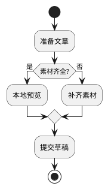
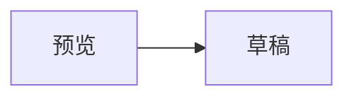
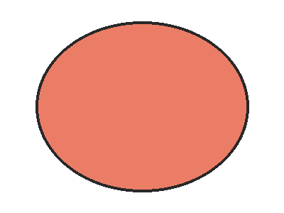

# 排版回归样本：全要素覆盖

这是一篇用于回归验证的样例文章，覆盖微信公众号排版的主要要素。正文包含中英文混排（WeChat、Markdown）、全角标点，以及“引号”和『嵌套引号』，用于检查字体回退与标点悬挂。

## 二级标题：列表与嵌套

无序列表：

- 第一项：中文条目
- 第二项：包含 `行内代码` 的条目
  - 嵌套项 A
  - 嵌套项 B
- 第三项：包含[一条普通链接](https://mp.weixin.qq.com)的条目

有序列表：

1. 准备素材
2. 本地预览
   1. 检查正文
   2. 检查封面
3. 提交草稿

## 二级标题：表格

| 功能 | 支持情况 | 说明 |
| --- | --- | --- |
| 中文段落 | 支持 | 全角标点与中英文混排 |
| 表格 | 支持 | 宽表格在窄屏下的表现需要人工确认 |
| 这是一个非常长的单元格用来测试窄屏下的换行表现是否正常 | 兼容 | 长文本应当正常折行而不是撑破容器 |

## 二级标题：代码

```python
def wechat_digest(text: str, limit: int = 100) -> str:
    """生成不超过 limit 的摘要。"""
    cleaned = " ".join(text.split())
    return cleaned[:limit]
```

行内代码如 `WCM_DATABASE_URL` 应当保持等宽样式。

## 二级标题：引用与提示

> 这是一段普通引用，用于检查引用块的左边框与底色。

> [!NOTE]
> 这是一个 callout（说明），标题与正文应有区分。

> [!WARNING]
> 这是警告类 callout，应当保留警示样式。

## 二级标题：图表

PlantUML 流程图：



Graphviz 关系图：


Mermaid（当前版本不渲染，源码保留在代码块中属于预期边界）：



## 二级标题：公式

行间公式：

$$
\int_{0}^{\infty} e^{-x^2} \, dx = \frac{\sqrt{\pi}}{2}
$$

行内公式如质能方程 $E = mc^2$ 应当以图片形式内嵌。

## 二级标题：长链接与引用来源

微信不允许正文外链，因此链接会被转换为文末参考链接：一条是[官方草稿箱文档](https://developers.weixin.qq.com/doc/offiaccount/Draft_Box/Add_draft.html)，另一条是更长的[永久素材文档](https://developers.weixin.qq.com/doc/offiaccount/Asset_Management/Adding_Permanent_Assets.html)，两条都应当正确进入参考链接区，且长地址在窄屏不撑破排版。

（已知边界：不带 `<>` 或 `[]()` 语法的裸 URL 不会被自动转换为链接，按普通文本输出。）

## 二级标题：图片

透明背景图片（相对路径，提交草稿时上传）：



---

以上就是全部要素。最后一个段落用于验证文末间距。
